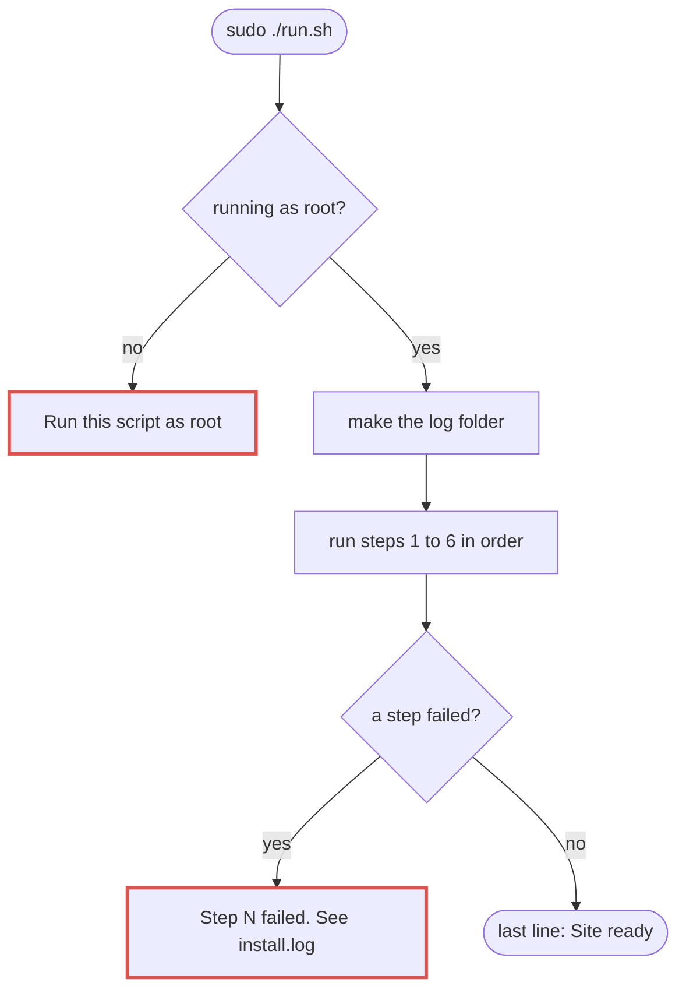
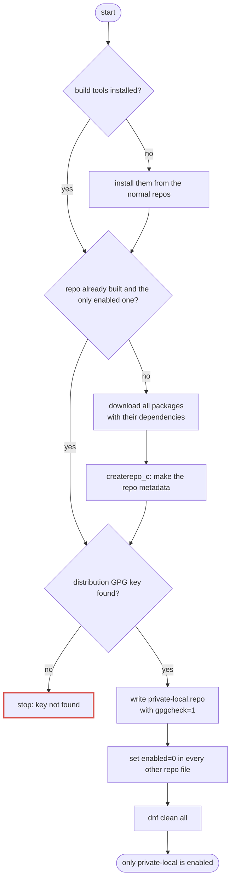
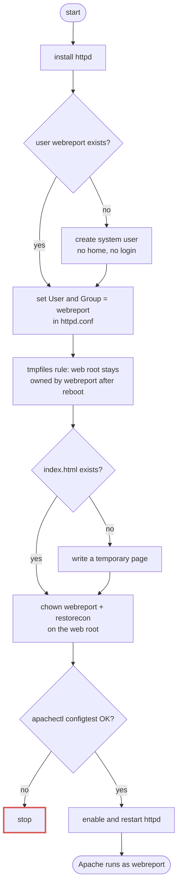
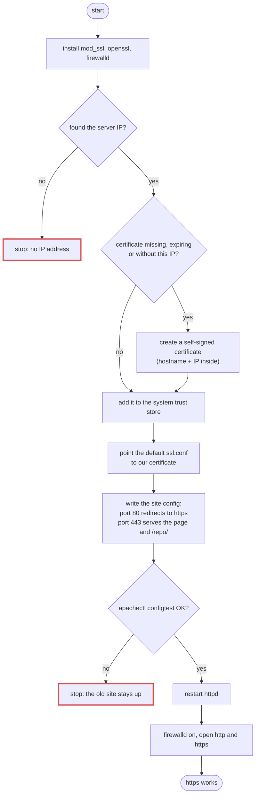
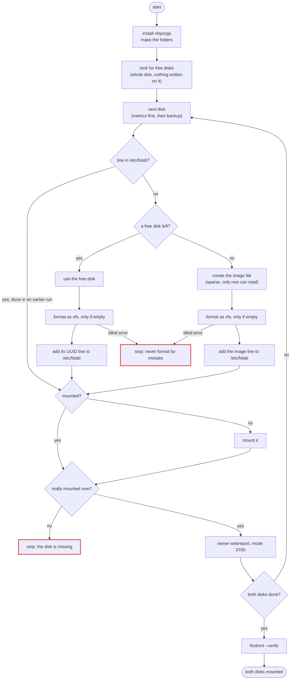
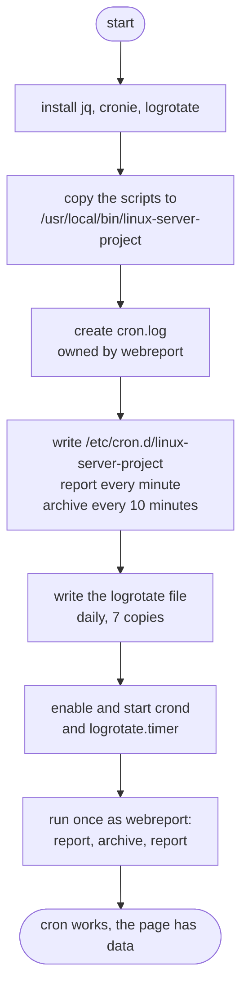
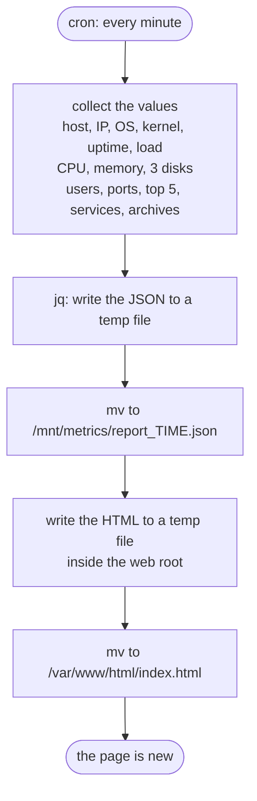
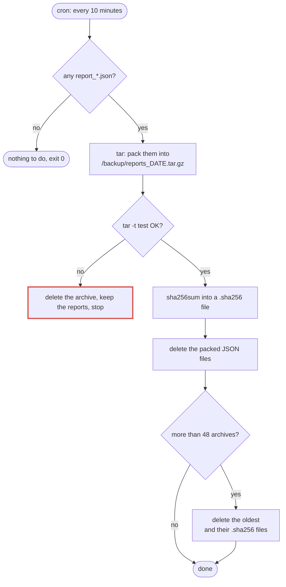
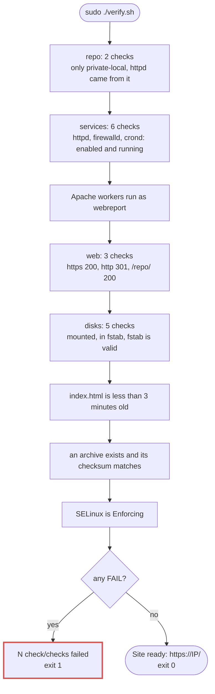
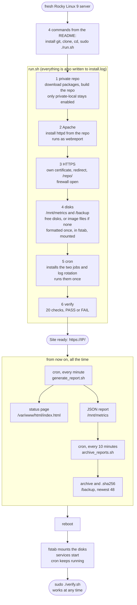

# Flowcharts

One chart for each script, then one big chart for the whole project. They are drawn from the real scripts in this repo.

**How to read them**

- **Rounded box** = start or end
- **Diamond** = a question (the script checks first, then decides)
- **Red border** = the script stops with an error
- Every script is safe to run again: the diamonds are the reason.

Contents: [run.sh](#runsh) · [Step 1](#step-1-setup_private_reposh) · [Step 2](#step-2-install_apachesh) · [Step 3](#step-3-configure_httpssh) · [Step 4](#step-4-mount_diskssh) · [Step 5](#step-5-setup_cronssh) · [Step 5a](#step-5a-generate_reportsh) · [Step 5b](#step-5b-archive_reportssh) · [Step 6](#step-6-verifysh) · [The big picture](#the-big-picture)

---

## run.sh

Runs the six steps in order. Everything it prints goes to the screen **and** to `install.log`.

---

## Step 1 setup_private_repo.sh

Builds the server's **own** dnf repository. This is the only step that uses the internet.

---

## Step 2 install_apache.sh

Installs Apache **from the private repo** and makes it run as its own user.

---

## Step 3 configure_https.sh

HTTPS with our own certificate, the redirect, `/repo/`, and the firewall.

---

## Step 4 mount_disks.sh

Two disks. The script uses the **free real disks** it finds (any name: `sdb`, `vdb`, `nvme0n2`...). If there is no free disk, it makes an **image file** and uses that instead. The part inside the loop runs once for `/mnt/metrics` and once for `/backup`.

---

## Step 5 setup_crons.sh

Installs the two jobs and runs them once. The jobs run as `webreport`, not as root.

---

## Step 5a generate_report.sh

Run by cron **every minute**.

---

## Step 5b archive_reports.sh

Run by cron **every 10 minutes**.

---

## Step 6 verify.sh

Looks at everything, **changes nothing**. It runs all 20 checks, even after one fails.

---

## The big picture

The whole project, from the four commands to a server that keeps reporting after a reboot.

